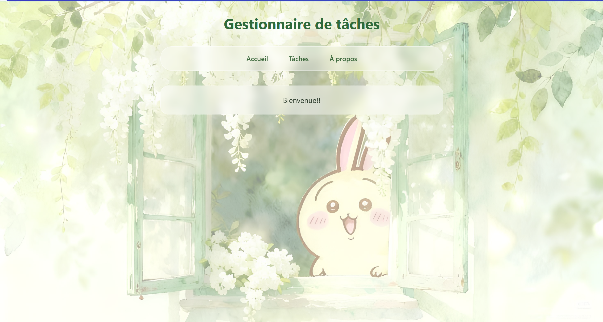
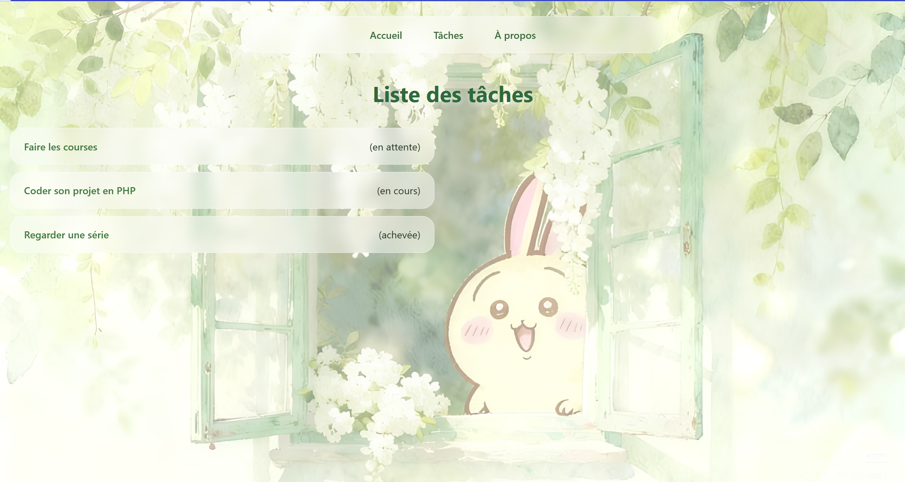
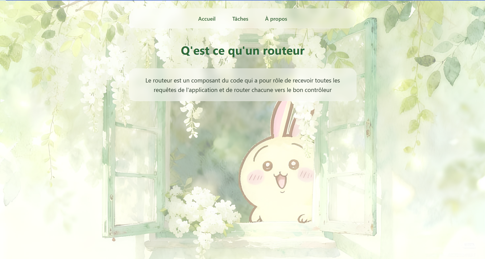

# Gestionnaire de tâches : MVC en PHP (V2)

Petit gestionnaire de tâches développé en **PHP** avec l'architecture **MVC**, un **routeur** maison et une base de données **MySQL**.
Projet réalisé dans le cadre du module R3.01 (PHP).

## Aperçu

### Accueil


### Liste des tâches


### À propos


## Fonctionnalités

- Routeur central dans `index.php` (toutes les URL passent par lui)
- Page **404** pour les URL inexistantes
- Page **À propos** : « Qu'est-ce qu'un routeur ? »
- Liste des tâches : `/tasks`
- Détail d'une tâche : `/tasks/{id}`
- Validation de l'id en deux niveaux :
  1. le routeur vérifie que l'id est un entier (`ctype_digit`)
  2. le contrôleur vérifie que la tâche existe en base
- Menu de navigation sur toutes les pages
- Mise en forme CSS avec image de fond
- Tâches stockées dans une base MySQL (statuts : *en attente*, *en cours*, *achevée*)

## Structure du projet

```
MVC/
├── .htaccess
├── index.php              # point d'entrée + routeur
├── style.css
├── database.sql           # script de création de la base
├── img/
│   └── fond.jpg
├── screenshots/           # captures d'écran du README
├── controllers/
│   ├── aboutController.php
│   ├── errorController.php
│   ├── homeController.php
│   └── taskController.php
├── models/
│   ├── database.php       # connexion PDO
│   └── task.php
└── views/
    ├── 404.php
    ├── about.php
    ├── home.php
    ├── task.php
    └── tasks.php
```

## Routes

| URL | Contrôleur | Résultat |
|-----|------------|----------|
| `/MVC/` | `homeController` | Page d'accueil avec menu |
| `/MVC/about` | `aboutController` | Page À propos |
| `/MVC/tasks` | `taskController::index()` | Liste des tâches |
| `/MVC/tasks/{id}` | `taskController::show()` | Une seule tâche |
| autre | `errorController` | Page 404 |

## Installation

### Prérequis

- [XAMPP](https://www.apachefriends.org/) (Apache + PHP + MySQL/MariaDB)
- Module Apache `mod_rewrite` activé

### Étapes

1. Cloner le dépôt dans le dossier `htdocs` de XAMPP :
   ```bash
   cd C:\xampp\htdocs
   git clone <url-du-depot> MVC
   ```
2. Démarrer **Apache** et **MySQL** dans le panneau XAMPP.
3. Ouvrir phpMyAdmin (`http://localhost/phpmyadmin`), onglet **SQL**, et exécuter le contenu de `database.sql`.
4. Vérifier les identifiants dans `models/database.php` (par défaut : `root`, sans mot de passe).
5. Ouvrir `http://localhost/MVC/`.

## Base de données

```sql
CREATE TABLE tasks (
    id INT AUTO_INCREMENT PRIMARY KEY,
    title VARCHAR(255) NOT NULL,
    status ENUM('en attente', 'en cours', 'achevée') NOT NULL DEFAULT 'en attente'
);
```

## Le `.htaccess` et les fichiers statiques

Avec la première version du `.htaccess`, **toutes** les requêtes étaient redirigées vers `index.php`, y compris celle de `style.css`. Le routeur ne connaissant pas cette URL, il renvoyait la page 404 et la feuille de style n'était jamais appliquée.

La version V2 ajoute une condition pour ne pas rediriger les fichiers qui existent réellement (CSS, images, JS) :

```apache
RewriteEngine On
RewriteBase /MVC/
RewriteCond %{REQUEST_FILENAME} !-f
RewriteRule ^(.*)$ index.php [QSA,L]
```

## Technologies

- PHP 8
- MySQL / MariaDB (PDO)
- Apache (`mod_rewrite`)
- HTML / CSS
